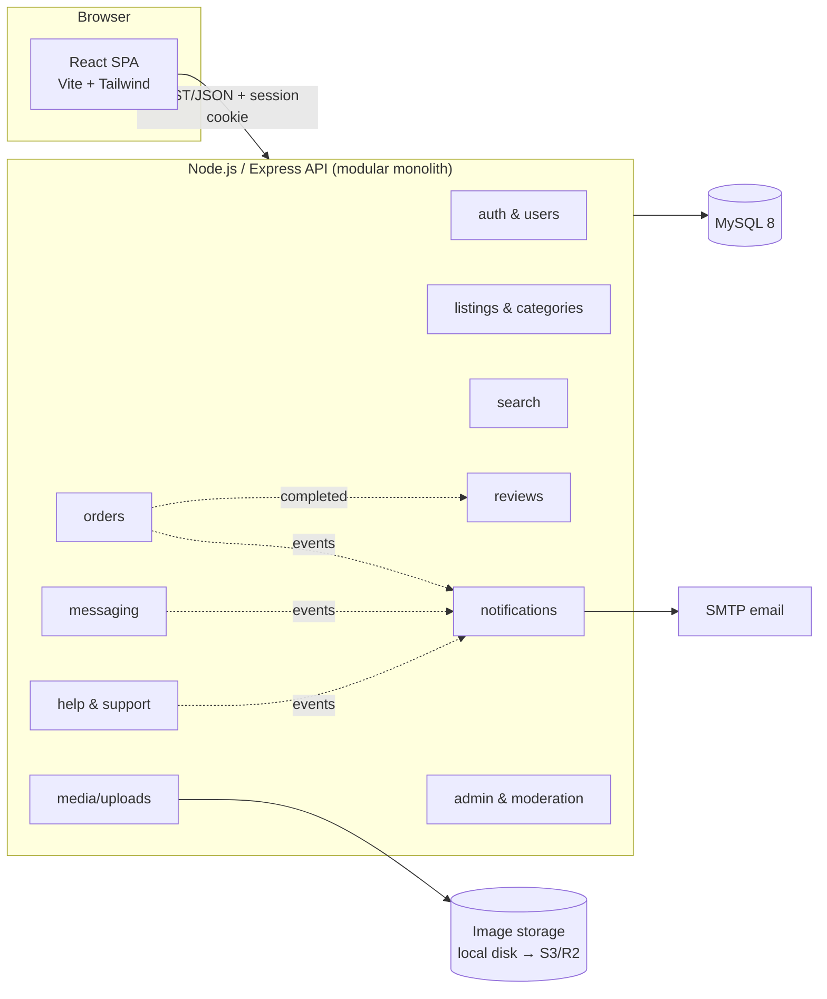
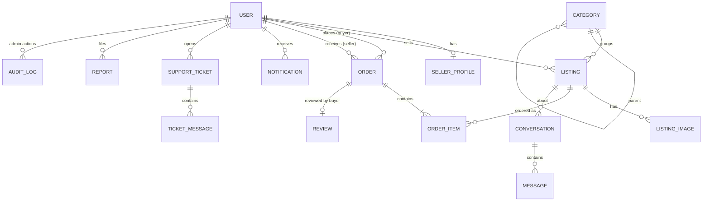

# Marketplace — Project Plan

Status: **Draft, awaiting approval.** No implementation code will be written until this plan is signed off.

---

## 1. Requirements

### Purpose and users
- A web marketplace for **general physical goods** (electronics, furniture, clothing, household items and similar), classifieds/eBay style.
- **Users:** one account type that can both buy and sell. A user becomes a seller by completing a seller profile. **Admins** moderate the platform.
- **Payments in v1 are offline.** The app tracks the order lifecycle, but money changes hands outside it (cash or mobile money on delivery/pickup). The seller marks an order as paid. This keeps card data and payouts out of scope for v1.
- **Region and currency: Zambia, Zambian kwacha (ZMW).** Prices are stored as DECIMAL(12,2), so ngwee are supported, and shown as `K 1,250.00`. Phone numbers use the +260 format. Location is a town/city plus one of the 10 provinces. The currency code lives in config, so it isn't hard-coded.
- **Platform:** a responsive web app that works well on phones. No native app in v1.
- **Scale:** small to start, tens to low hundreds of users and a few thousand listings. The design should reach about 10k users without a rewrite.

### Must-have (v1)
| Area | What's included |
|---|---|
| Accounts | Register/login (email + password), email verification, password reset, profile, seller profile (shop name, location, contact preference), account deletion |
| Listings | Create/edit/delete, categories, condition, price, quantity, location, up to 8 images, statuses: draft / active / sold / removed |
| **Search** | Keyword full-text search plus filters (category, price range, condition, location) and sort (newest, price, relevance), paginated. Category browsing and a seller's shop page |
| Orders | "Buy now" per listing with quantity. Lifecycle: placed → accepted → ready/shipped → completed, or declined/cancelled. Offline payment flag set by the seller. Order history for both sides. Stock is reserved when an order is placed |
| Messaging | Buyer–seller conversation per listing, with unread counts. Polling-based (no websockets in v1) |
| Reviews | A buyer rates a seller (1–5 plus a comment) once per completed order. Seller rating is shown on listings and the shop page |
| Notifications | In-app notifications plus email for key events (new order, status change, new message, ticket reply) |
| **Help & support** | Help centre (FAQ articles, searchable), contact/support tickets with threaded replies, "report this listing/user" |
| Admin | Dashboard (counts), manage users (suspend/ban), moderate listings (remove/restore), handle reports, answer support tickets, manage categories and FAQ articles, audit log of admin actions |

### Later (explicitly out of v1)
- Online payments and escrow: Zambian mobile money (MTN MoMo, Airtel Money, Zamtel Kwacha) and cards through an aggregator such as Lenco, DPO Pay or Flutterwave. Also seller payouts and fees/commissions
- Multi-seller cart (the v1 schema already supports multi-item orders, so this is UI and logic only)
- Real-time messaging (websockets), push notifications
- Saved/favourite listings, saved searches and alerts
- Shipping integrations and delivery tracking
- Native mobile app / PWA install
- Promoted listings, seller subscriptions
- Multi-currency and multi-language

### Constraints
- **Solo developer**, built in Claude Code cloud sessions on a limited credit budget. So: one deployable app, few moving parts, and no service that isn't strictly needed.
- **Compliance:**
  - *Payment data:* none stored in v1 (offline payments), so PCI scope is zero. When a provider is added later, use a hosted checkout so card data never reaches our servers.
  - *PII:* store only what's needed (name, email, optional phone, rough location). Passwords are hashed with argon2. HTTPS only. A seller's phone number is shown only to buyers with an accepted order. Privacy policy and terms pages, user data export and account deletion (in line with Zambia's **Data Protection Act No. 3 of 2021**: users consent at sign-up, data is collected for a stated purpose, and users have access/deletion rights. If the platform grows, check whether it must register as a data controller with the Office of the Data Protection Commissioner).
- **House rules:** search and help/support are always included. Backups, scripts and test artifacts live **inside the repo** (`scripts/`, `backups/`, `tests/artifacts/`), not in temp folders.

---

## 2. Architecture & Modules

**Shape: a modular monolith.** That means one Express API and one React app, with code split into feature modules that own their routes, services and tables. The reason: a solo developer gets one thing to build, test and deploy, and the module boundaries stay clean enough to split out later if ever needed.

### Modules
| Module | Responsibility |
|---|---|
| `auth` / `users` | Registration, login/logout, sessions, email verification, password reset, profiles and seller profiles, roles (user/admin), account deletion and export |
| `listings` | CRUD for listings, categories and condition, listing status and stock, ownership checks |
| `media` | Image upload, validation (type/size), resizing to thumbnail and full size with `sharp`, storage behind a small driver interface (local disk now, S3-compatible later) |
| `search` | Full-text keyword search, filters, sorting and pagination over listings, plus search within help articles |
| `orders` | Placing orders, stock reservation, status state machine with permission checks per transition, offline "mark paid", order history |
| `messaging` | Conversations tied to a listing between a buyer and a seller, messages, unread counts |
| `reviews` | One review per completed order, seller rating aggregates |
| `notifications` | Stores in-app notifications and sends templated emails. Other modules call it through an in-process event bus |
| `support` | FAQ/help articles, support tickets and replies, user reports (listing/user/message) |
| `admin` | Admin-only endpoints: dashboard stats, user suspension, listing moderation, report and ticket queues, category and FAQ management, audit log |

### Core data entities

Key fields and rules:
- **User**: email (unique), password_hash, name, phone (optional), role (`user`/`admin`), status (`active`/`suspended`/`deleted`), email_verified_at.
- **Listing**: seller_id, category_id, title, description, price (DECIMAL), currency, condition, quantity, location, status, with a `FULLTEXT(title, description)` index.
- **Order**: buyer_id, seller_id, status, total, payment_status (`unpaid`/`paid_offline`), delivery notes. Each **OrderItem** stores a snapshot of the listing title and price at the time of purchase.
- **Review**: order_id (unique), reviewer_id, seller_id, rating, comment.
- **Conversation**: unique (listing_id, buyer_id). The seller is implied by the listing.
- **Report**: target_type plus target_id, reason, status (`open`/`actioned`/`dismissed`).
- **AuditLog**: actor_id, action, target, JSON metadata, timestamp.

### How the pieces communicate
- Browser to API: REST/JSON under `/api/v1`, authenticated with an httpOnly session cookie and CSRF protection.
- Module to module: direct service calls inside the process for reads. Side effects such as "send a notification" go through a small typed event bus in the same process. No message broker is needed at this scale.
- The API serves the built React app in production, so there is one origin and one process to deploy.

---

## 3. Tech Stack & Rationale

| Layer | Choice | Why |
|---|---|---|
| Language | **TypeScript** (frontend and backend) | One language end to end. Types shared between API and UI catch mistakes early, which matters when one person maintains everything |
| Backend | **Node.js 22 LTS + Express 5** | Your proven stack. Simple, well known, and more than enough for this scale |
| Database | **MySQL 8** | Your preferred DB. Its built-in InnoDB FULLTEXT covers search without a separate search service |
| ORM / migrations | **Prisma** | Type-safe queries, versioned migrations and a seed script. Raw SQL is used for the FULLTEXT search queries |
| Validation | **Zod** (shared package) | The same schemas validate API input and frontend forms |
| Auth | **express-session** with a MySQL session store, **argon2** password hashing | Server sessions with httpOnly cookies are simpler and safer than JWT for a single-origin web app, and allow instant logout and suspension |
| Search | **MySQL FULLTEXT** plus indexed filter columns | Meets the search requirement at this scale with no extra infrastructure. It sits behind a `search` module interface, so Meilisearch can be swapped in later if needed |
| Frontend | **React 19 + Vite + React Router** | Your proven stack with fast builds |
| Data fetching | **TanStack Query** | Caching and loading states, and simple polling for messages and notifications |
| UI | **Tailwind CSS** (plus a few headless components) | Fast to build responsive, mobile-friendly screens without a heavy component library |
| Images | **multer + sharp**, storage-driver interface | Local disk in dev and on a VPS. Cloudflare R2/S3 can be swapped in via config |
| Email | **Nodemailer** (SMTP) | Works with any provider (Brevo, Mailgun, Gmail SMTP). In dev, emails are logged to the console/file |
| Security | helmet, rate limiting (auth and messaging), CSRF tokens, input validation, upload type/size checks | Basic web hardening for a public site handling PII |
| Testing | **Vitest + Supertest** (API integration against a real MySQL test DB), **Vitest + Testing Library** (key components), **Playwright** (a few end-to-end smoke flows) | Integration tests give the most confidence per test. Playwright is kept to the critical paths so test runs stay cheap |
| Repo layout | npm workspaces: `apps/api`, `apps/web`, `packages/shared` | One repo and one install, with shared types and schemas |
| Deploy | **Docker Compose on one small VPS** (app + MySQL + Caddy for automatic HTTPS), nightly `mysqldump` into `backups/` | Cheapest predictable hosting for a solo developer, with backups inside the repo directory as you require |
| CI | GitHub Actions: lint, typecheck, API tests on push | Catches regressions without manual runs |

---

## 4. Workflow Breakdown

Each phase ends with working, tested code committed and pushed. The foundational and riskiest pieces (data model, auth, image uploads, search) come first. Sizes: **S** ≈ under half a session, **M** ≈ one session, **L** ≈ 1–2 sessions.

| # | Phase | What gets built | Depends on | Size |
|---|---|---|---|---|
| 0 | **Scaffolding** | npm workspaces, TS config, ESLint/Prettier, Express app skeleton (health route, error handler, logging), Vite React app skeleton with routing and layout, shared package, `.env.example`, local MySQL setup script in `scripts/`, CI workflow | — | S |
| 1 | **Data layer** | Full Prisma schema for all v1 entities, first migration, FULLTEXT indexes, seed script (categories, Zambian provinces, admin user, demo sellers/listings priced in ZMW, FAQ articles), test-DB reset helper | 0 | M |
| 2 | **Auth & accounts** | Register/login/logout, sessions, CSRF, email verification, password reset, profile and seller-profile pages, role guard middleware, rate limiting, account deletion and export | 1 | M |
| 3 | **Listings & media** | Listing CRUD API and forms, image upload/resize/storage driver, categories, listing detail page, "My listings" dashboard, ownership checks | 2 | L |
| 4 | **Search & browse** | Search API (FULLTEXT plus filters, sort and pagination), home/category pages, search page with filter UI, URL-synced query state, seller shop page | 3 | M |
| 5 | **Orders** | Buy-now flow, stock reservation (transactional), order state machine with per-role transitions, mark paid offline, buyer and seller order pages, notification hooks | 3 | M |
| 6 | **Messaging & notifications** | Conversations and messages API, inbox UI with polling, unread badges, notifications module (in-app list and email templates) wired to order and message events | 5 | M |
| 7 | **Reviews** | Review after completed order, rating aggregates on listing and shop, review list | 5 | S |
| 8 | **Help & support** | Help centre with searchable FAQ, support tickets with threaded replies, report listing/user/message, contact page, terms and privacy pages | 2, 4 | M |
| 9 | **Admin & moderation** | Admin dashboard, user suspend/ban, listing remove/restore, reports queue, ticket queue, category and FAQ management, audit log | 3–8 | M |
| 10 | **Hardening & testing** | Fill test gaps on critical paths, Playwright smoke flows (sign up → list item → search → order → message → review; admin moderation), security pass, accessibility and mobile layout pass, performance check on search | 0–9 | M |
| 11 | **Deploy** | Dockerfile, docker-compose (app, MySQL, Caddy), production config, `scripts/backup-db.sh` writing to `backups/`, restore script, deploy README | 10 | S–M |

Testing is not saved for the end. Every phase adds API integration tests for its own endpoints, and phase 10 fills the gaps and adds the end-to-end runs.

### Repo conventions
- `scripts/`: setup, seed, backup and restore scripts
- `backups/`: database dumps (the folder is kept in git, the dump files are git-ignored)
- `tests/artifacts/`: Playwright reports and screenshots (git-ignored contents)
- Commits are small and per phase. Each phase is pushed when its tests pass.

---

## 5. Assumptions / Open Questions

Defaults I'm assuming. Correct any of them:
1. **Region and currency:** ✅ confirmed as Zambia / ZMW. Zambia only in v1, with no cross-border listings.
2. **Location** is a free-text town/city plus a province dropdown (no maps in v1).
3. **One account can both buy and sell.** No separate seller sign-up or seller verification/KYC in v1.
4. **Listings go live immediately.** Admins moderate after the fact through reports. The alternative is admin approval before a listing is visible.
5. **TypeScript** rather than plain JavaScript. This is a small change from your past projects, chosen because shared types help a solo maintainer.
6. **Deploy target = one small VPS with Docker Compose.** Railway/Render plus a managed MySQL is an alternative if you'd rather not manage a server. Do you have a domain or hosting already?
7. **Email provider:** SMTP credentials will be needed before production. Dev uses a console/file logger.
8. **No online payments in v1.** The order model includes `payment_status` and a provider-agnostic design, so Zambian mobile money (MTN MoMo, Airtel Money, Zamtel) or card payments through an aggregator can be added later as a separate phase.
9. **Branding:** working name "Marketplace". Do you want a specific name, logo or colour scheme?

---

## 6. Next Steps

1. **You review this plan** and approve it or request changes (I'll revise and re-confirm).
2. On approval, start **Phase 0 (Scaffolding)** on branch `claude/blissful-goldberg-fs0v88`, then work through the phases in order, pushing after each.
3. After each phase, a short check-in: what was built, how to try it, and anything that needs your input.
