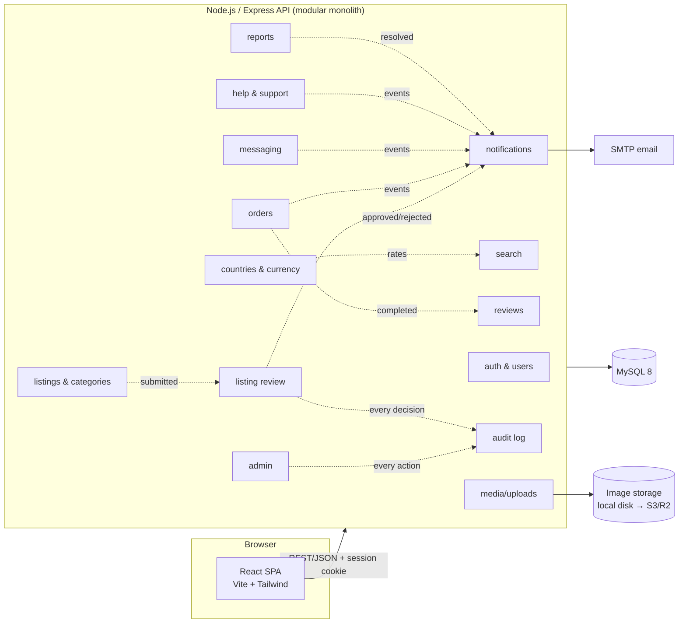
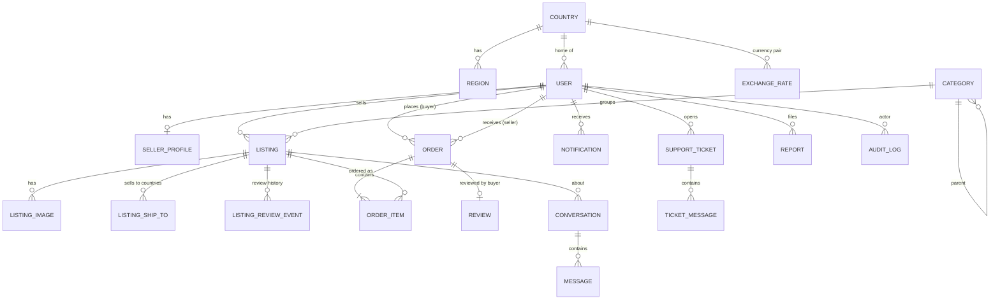

# TZed — Project Plan

Status: **Draft, awaiting approval.** No implementation code will be written until this plan is signed off.

**TZed** (Tanzania + "Zed", Zambia) is a cross-border marketplace for buyers and sellers in **Tanzania and Zambia**.

---

## 1. Requirements

### Purpose and users
- A web marketplace for **general physical goods** (electronics, furniture, clothing, household items and similar), classifieds/eBay style.
- **Two countries: Tanzania (TZ) and Zambia (ZM).** Buyers and sellers can be in either country. The main use case is **Tanzanian sellers selling to Zambian buyers**, but every direction works (TZ→ZM, ZM→TZ and within one country).
- **Users:** one account type that can both buy and sell. Each user belongs to a country. A user becomes a seller by completing a seller profile. **Admins** moderate the platform.
- **Every listing is reviewed by an admin before it goes public.** New listings start as *pending review*. An admin approves them or rejects them with a reason. Edits to the title, description, price, category or images send an active listing back for review. Changes to quantity or status (e.g. marking it sold) do not.
- **Payments in v1 are offline.** The app tracks the order lifecycle, but money changes hands outside it (cash on pickup/delivery or mobile money). The seller marks an order as paid. This keeps card data and payouts out of scope for v1.
- **Platform:** a responsive web app that works well on phones. No native app in v1.
- **Scale:** small to start, tens to low hundreds of users and a few thousand listings. The design should reach about 10k users without a rewrite.

### Countries and currencies
| | Tanzania | Zambia |
|---|---|---|
| Currency | Tanzanian shilling, **TZS** (shown `TSh 25,000`, whole shillings) | Zambian kwacha, **ZMW** (shown `K 1,250.00`, with ngwee) |
| Phone format | +255 | +260 |
| Location fields | Town/city plus one of the **31 regions** | Town/city plus one of the **10 provinces** |

- **Each listing is priced in its seller's currency.** The original price is always shown.
- **Buyers also see an approximate price in their own currency**, e.g. `TSh 250,000 (≈ K 2,480)`. This uses an exchange rate that an **admin updates manually** (no paid FX API; the date of the last update is shown). A header toggle lets anyone switch the display currency.
- **Two-way currency converter** for clarity on both sides. Zambians can convert kwacha → shillings and shillings → kwacha, and Tanzanians can do the same. Type an amount into either box (TZS or ZMW) and the other box updates instantly. A swap button flips the direction. The current rate is shown both ways (`1 ZMW = X TZS`, `1,000 TZS = Y ZMW`) with the date it was last updated, plus a note that the result is approximate. The converter is reachable from the site header on every page, as a full `/converter` page, and as a "Convert" button on each listing that opens it pre-filled with that listing's price.
- An order stores the price in the listing's currency, plus the exchange rate and converted amount at the moment the order is placed. A later rate change doesn't alter past orders.
- Countries are a database table, not hard-coded, so a third country can be added later.

### Cross-border delivery
- On each listing the seller chooses **who they sell to**: their own country only, or both countries.
- The seller also chooses **delivery options**: buyer collects, seller delivers locally, or seller sends cross-border (e.g. bus or courier via the Tunduma–Nakonde border), with a free-text note on delivery cost and time.
- Buyers can filter search by "available in my country".
- Cross-border listings show a notice: **import duties and customs are agreed between buyer and seller. TZed does not handle customs.**

### Must-have (v1)
| Area | What's included |
|---|---|
| Accounts | Register/login (email + password), country choice at sign-up, email verification, password reset, profile, seller profile (shop name, location, contact preference), account deletion and data export |
| Listings | Create/edit/delete, categories, condition, price in the seller's currency, quantity, location, sell-to countries, delivery options, up to 8 images. Statuses: draft / **pending review** / active / rejected / sold / removed |
| **Listing approval** | Admin review queue (oldest first), approve or reject with a reason, the seller is notified, the seller can fix a rejected listing and resubmit it. Only *active* listings appear in search |
| **Currency converter** | Two-way TZS ⇄ ZMW converter: in the header on every page, on a `/converter` page, and pre-filled from a listing's price. Uses the same admin-set rate as listing prices, so the converter and listed prices always agree. Works for guests too, no sign-in needed |
| **Search** | Keyword full-text search plus filters (country, available in my country, category, price range in the buyer's display currency, condition, location) and sort (newest, price, relevance), paginated. Category browsing and a seller's shop page |
| Orders | "Buy now" per listing with quantity and a chosen delivery option. Lifecycle: placed → accepted → ready/shipped → completed, or declined/cancelled. Offline payment flag set by the seller. Order history for both sides. Stock is reserved when an order is placed |
| Messaging | Buyer–seller conversation per listing, with unread counts. Polling-based (no websockets in v1) |
| Reviews | A buyer rates a seller (1–5 plus a comment) once per completed order. Seller rating is shown on listings and the shop page |
| Notifications | In-app notifications plus email for key events (listing approved or rejected, new order, status change, new message, ticket reply, report outcome) |
| **Help & support** | Help centre (FAQ articles, searchable, including cross-border buying tips), contact/support tickets with threaded replies |
| **Reports** | Any signed-in user can **report a listing, a user or a message** with a reason (scam/fraud, prohibited item, wrong category, offensive, other) and details. Reports go to an admin queue. The admin dismisses a report or acts on it (remove the listing, suspend the user) with a note, and the reporter is told the outcome. Several reports on one listing are grouped together, and admins can see how many reports a user or listing has |
| **Audit log** | Every admin action (approve/reject a listing, remove or restore a listing, suspend or reinstate a user, resolve a report, change an exchange rate, edit categories or FAQs) is written to an append-only audit log: who, what, which item, before/after values, and when. Admins can filter it by admin, action, item and date. Security events (logins, failed logins, password resets) are logged too |
| Admin | Dashboard (counts plus pending-review and open-report badges), the listing review queue, the reports queue, user management (suspend/ban), listing moderation (remove/restore), support ticket queue, exchange-rate management, category and FAQ management, audit log viewer |

### Later (explicitly out of v1)
- Online payments and escrow. Tanzania: M-Pesa, Mixx by Yas (Tigo Pesa), Airtel Money, HaloPesa. Zambia: MTN MoMo, Airtel Money, Zamtel Kwacha. Cards too. All through an aggregator covering both countries (e.g. DPO Pay or Flutterwave) or local ones (Selcom/ClickPesa for Tanzania, Lenco for Zambia). Seller payouts and fees/commissions
- Automatic exchange rates from an FX API
- Swahili interface (v1 is English only, but all UI text goes through a translation layer from day one, so adding Swahili later means translating text, not rewriting code)
- Multi-seller cart (the v1 schema already supports multi-item orders, so this is UI and logic only)
- Real-time messaging (websockets), push notifications, SMS notifications
- Saved/favourite listings, saved searches and alerts
- Shipping/courier integrations and delivery tracking
- Native mobile app / PWA install
- Promoted listings, seller subscriptions, seller verification (ID/KYC)

### Constraints
- **Solo developer**, built in Claude Code cloud sessions on a limited credit budget. So: one deployable app, few moving parts, and no service that isn't strictly needed.
- **Compliance** (planning notes, not legal advice):
  - *Payment data:* none stored in v1 (offline payments), so PCI scope is zero. When a provider is added later, use a hosted checkout so card data never reaches our servers.
  - *PII:* store only what's needed (name, email, optional phone, country, rough location). Passwords are hashed with argon2. HTTPS only. A seller's phone number is shown only to buyers with an accepted order. Users consent at sign-up, can export their data, and can delete their account. Privacy policy and terms pages.
  - *Tanzania:* **Personal Data Protection Act 2022.** Organisations that collect personal data must register with the **Personal Data Protection Commission (PDPC)**, and sending personal data out of the country has its own rules.
  - *Zambia:* **Data Protection Act No. 3 of 2021.** Data controllers may need to register with the **Office of the Data Protection Commissioner**, and there are cross-border transfer rules.
  - *Effect on the build:* where the server is hosted is a compliance decision, since one country's data will always be stored "abroad". Both registrations should be checked before public launch. The code supports this through consent records, data export/deletion and the audit log.
  - *Prohibited items:* a prohibited-items policy page (weapons, drugs, counterfeit goods, wildlife products and similar) that admins apply during listing review.
- **House rules:** search and help/support are always included. Backups, scripts and test artifacts live **inside the repo** (`scripts/`, `backups/`, `tests/artifacts/`), not in temp folders.

---

## 2. Architecture & Modules

**Shape: a modular monolith.** That means one Express API and one React app, with code split into feature modules that own their routes, services and tables. The reason: a solo developer gets one thing to build, test and deploy, and the module boundaries stay clean enough to split out later if ever needed.

### Modules
| Module | Responsibility |
|---|---|
| `auth` / `users` | Registration, login/logout, sessions, email verification, password reset, profiles and seller profiles, user country, roles (user/admin), consent records, account deletion and export |
| `geo` | Countries, regions/provinces, currencies, admin-managed exchange rates, the public `GET /rates` endpoint behind the converter, money formatting and conversion helpers (shared with the frontend, so the converter runs instantly in the browser) |
| `listings` | CRUD for listings, categories and condition, sell-to countries, delivery options, listing status and stock, ownership checks |
| `moderation` | Listing review workflow: submit for review, approve, reject with reason, resubmit, and send edited listings back for review |
| `media` | Image upload, validation (type/size), resizing to thumbnail and full size with `sharp`, storage behind a small driver interface (local disk now, S3-compatible later) |
| `search` | Full-text keyword search over active listings, with country and availability filters, price filtering and sorting in the buyer's currency, pagination. Also search within help articles |
| `orders` | Placing orders (with an exchange-rate snapshot), stock reservation, status state machine with permission checks per transition, offline "mark paid", order history |
| `messaging` | Conversations tied to a listing between a buyer and a seller, messages, unread counts |
| `reviews` | One review per completed order, seller rating aggregates |
| `notifications` | Stores in-app notifications and sends templated emails. Other modules call it through an in-process event bus |
| `support` | FAQ/help articles, support tickets and replies |
| `reports` | User reports on listings, users and messages. Grouping per target, the admin resolution workflow, telling the reporter the outcome |
| `audit` | Append-only log of admin and security events. Written by a single `audit.record()` call from every admin and moderation action. Read-only viewer with filters |
| `admin` | Admin-only endpoints and UI: dashboard, review queue, reports queue, users, listing moderation, tickets, exchange rates, categories and FAQs, audit viewer |

### Core data entities

Key fields and rules:
- **Country**: code (`TZ`/`ZM`), name, currency_code (`TZS`/`ZMW`), currency minor units (0 for TZS, 2 for ZMW), phone prefix. Each **Region** belongs to a country.
- **ExchangeRate**: base_currency (`ZMW`), quote_currency (`TZS`), rate (how many TZS one ZMW buys), set_by (admin), effective_at. Only **one** rate is stored per pair, and the reverse direction is calculated from it (1 ÷ rate). This way TZS→ZMW and ZMW→TZS can never disagree. The newest row is the current rate, and the full history is kept.
- **User**: email (unique), password_hash, name, phone (optional), country_id, role (`user`/`admin`), status (`active`/`suspended`/`deleted`), email_verified_at, consent_at.
- **Listing**: seller_id, category_id, title, description, price (DECIMAL), currency (the seller's), condition, quantity, country_id, region_id, town, delivery options, status (`draft`/`pending_review`/`active`/`rejected`/`sold`/`removed`), with a `FULLTEXT(title, description)` index. **ListingShipTo** holds the countries a listing sells to.
- **ListingReviewEvent**: listing_id, admin_id, decision (`submitted`/`approved`/`rejected`), reason, timestamp. This is the full approval history of each listing.
- **Order**: buyer_id, seller_id, status, currency, total, buyer_currency, fx_rate, buyer_total (snapshots), payment_status (`unpaid`/`paid_offline`), delivery option, delivery notes. Each **OrderItem** stores a snapshot of the listing title and price at the time of purchase.
- **Review**: order_id (unique), reviewer_id, seller_id, rating, comment.
- **Conversation**: unique (listing_id, buyer_id). The seller is implied by the listing.
- **Report**: reporter_id, target_type (`listing`/`user`/`message`), target_id, reason, details, status (`open`/`actioned`/`dismissed`), resolved_by, resolution_note, resolved_at.
- **AuditLog** (append-only, never edited or deleted through the app): actor_id, action (e.g. `listing.approve`, `user.suspend`, `fx.update`, `auth.login_failed`), target_type, target_id, before/after JSON, IP address, timestamp.

### How the pieces communicate
- Browser to API: REST/JSON under `/api/v1`, authenticated with an httpOnly session cookie and CSRF protection.
- Module to module: direct service calls inside the process for reads. Side effects such as "send a notification" or "write an audit entry" go through a small typed event bus in the same process. No message broker is needed at this scale.
- The API serves the built React app in production, so there is one origin and one process to deploy.

---

## 3. Tech Stack & Rationale

| Layer | Choice | Why |
|---|---|---|
| Language | **TypeScript** (frontend and backend), ✅ confirmed | One language end to end. Types shared between API and UI catch mistakes early, which matters when one person maintains everything |
| Backend | **Node.js 22 LTS + Express 5** | Your proven stack. Simple, well known, and more than enough for this scale |
| Database | **MySQL 8** | Your preferred DB. Its built-in InnoDB FULLTEXT covers search without a separate search service |
| ORM / migrations | **Prisma** | Type-safe queries, versioned migrations and a seed script. Raw SQL is used for the FULLTEXT and currency-converted price queries |
| Validation | **Zod** (shared package) | The same schemas validate API input and frontend forms |
| Money | Prices stored as DECIMAL with the currency code alongside. A shared `money` helper does formatting and conversion | TZS and ZMW use different minor units, so one helper keeps rounding and display consistent |
| i18n | **react-i18next** (English only in v1) | Swahili can be added later as a translation file instead of a rewrite |
| Auth | **express-session** with a MySQL session store, **argon2** password hashing | Server sessions with httpOnly cookies are simpler and safer than JWT for a single-origin web app, and allow instant logout and suspension |
| Search | **MySQL FULLTEXT** plus indexed filter columns | Meets the search requirement at this scale with no extra infrastructure. It sits behind a `search` module interface, so Meilisearch can be swapped in later if needed |
| Frontend | **React 19 + Vite + React Router** | Your proven stack with fast builds |
| Data fetching | **TanStack Query** | Caching and loading states, and simple polling for messages and notifications |
| UI | **Tailwind CSS** (plus a few headless components) | Fast to build responsive, mobile-friendly screens without a heavy component library. Pages are kept light for slower mobile connections |
| Images | **multer + sharp**, storage-driver interface | Images are compressed to WebP to keep pages light. Local disk in dev and on the server. Cloudflare R2/S3 can be swapped in via config |
| Email | **Nodemailer** (SMTP) | Works with any provider (Brevo, Mailgun, Gmail SMTP). In dev, emails are logged to the console/file |
| Security | helmet, rate limiting (auth, messaging, reports), CSRF tokens, input validation, upload type/size checks | Basic web hardening for a public site handling PII |
| Testing | **Vitest + Supertest** (API integration against a real MySQL test DB), **Vitest + Testing Library** (key components), **Playwright** (a few end-to-end smoke flows) | Integration tests give the most confidence per test. Playwright is kept to the critical paths so test runs stay cheap |
| Repo layout | npm workspaces: `apps/api`, `apps/web`, `packages/shared` | One repo and one install, with shared types, schemas and money helpers |
| Deploy | **Docker Compose**, ✅ confirmed (app + MySQL + Caddy for automatic HTTPS), nightly `mysqldump` into `backups/` | Runs the same locally and on any server. The hosting provider and region can be chosen later without code changes |
| CI | GitHub Actions: lint, typecheck, API tests on push | Catches regressions without manual runs |

---

## 4. Workflow Breakdown

Each phase ends with working, tested code committed and pushed. The foundational and riskiest pieces (data model including multi-currency, auth, listing approval, image uploads, search) come first. Sizes: **S** ≈ under half a session, **M** ≈ one session, **L** ≈ 1–2 sessions.

| # | Phase | What gets built | Depends on | Size |
|---|---|---|---|---|
| 0 | **Scaffolding** | npm workspaces, TS config, ESLint/Prettier, Express app skeleton (health route, error handler, logging), Vite React app skeleton with routing, TZed layout and i18n setup, shared package, `.env.example`, local MySQL setup script in `scripts/`, Docker Compose for dev, CI workflow | — | S |
| 1 | **Data layer** | Full Prisma schema for all v1 entities, first migration, FULLTEXT indexes, shared `money` helper (formatting, rounding, two-way conversion) with tests, public `GET /api/v1/rates` endpoint, **currency converter** (header widget, `/converter` page, two-way inputs, swap button, rate and last-updated date), seed script (TZ and ZM countries, 31 regions plus 10 provinces, a starting TZS↔ZMW rate, categories, admin user, demo sellers in both countries, demo listings, FAQ articles), test-DB reset helper | 0 | M |
| 2 | **Auth, accounts & audit core** | Register/login/logout with country, sessions, CSRF, email verification, password reset, profile and seller-profile pages, role guard middleware, rate limiting, consent, account deletion and export. Also the **audit module** (`audit.record()` plus security events), because every later admin feature writes to it | 1 | M |
| 3 | **Listings, media & approval** | Listing CRUD API and forms (price in the seller's currency, sell-to countries, delivery options), image upload/resize/storage, categories, listing detail page with converted price, a "Convert" button that opens the converter pre-filled, and cross-border notice, "My listings" dashboard with status and rejection reasons. **Review workflow**: submit, admin review queue page, approve/reject with reason, resubmit, edits sent back for review, every decision audit-logged | 2 | L |
| 4 | **Search & browse** | Search API (FULLTEXT plus country, available-in-my-country, category and condition filters, price range and sort in the buyer's display currency, pagination), home/category pages, search page with filter UI, URL-synced query state, currency toggle, seller shop page | 3 | M |
| 5 | **Orders** | Buy-now flow with delivery option, exchange-rate snapshot, stock reservation (transactional), order state machine with per-role transitions, mark paid offline, buyer and seller order pages, notification hooks | 3 | M |
| 6 | **Messaging & notifications** | Conversations and messages API, inbox UI with polling, unread badges, notifications module (in-app list and email templates) wired to listing-review, order and message events | 5 | M |
| 7 | **Reviews** | Review after completed order, rating aggregates on listing and shop, review list | 5 | S |
| 8 | **Help, support & reports** | Help centre with searchable FAQ (including cross-border buying guide and prohibited-items policy), support tickets with threaded replies, contact page, terms and privacy pages. **Reports**: report a listing, user or message, admin reports queue grouped by target, resolve or dismiss with a note, reporter told the outcome, all audit-logged | 2, 4, 6 | M |
| 9 | **Admin & moderation** | Admin dashboard with pending-review and open-report badges, user suspend/ban, listing remove/restore, ticket queue, **exchange-rate management**, category and FAQ management, **audit log viewer** with filters | 3–8 | M |
| 10 | **Hardening & testing** | Fill test gaps on critical paths, Playwright smoke flows (a Tanzanian seller lists an item → admin approves → a Zambian buyer searches in ZMW → orders → messages → reviews; report → admin resolves → audit entry), security pass, accessibility and mobile layout pass, performance check on search | 0–9 | M |
| 11 | **Deploy** | Production Dockerfile, docker-compose (app, MySQL, Caddy), production config, `scripts/backup-db.sh` writing to `backups/`, restore script, deploy README | 10 | S–M |

Testing is not saved for the end. Every phase adds API integration tests for its own endpoints, and phase 10 fills the gaps and adds the end-to-end runs.

### Repo conventions
- `scripts/`: setup, seed, backup and restore scripts
- `backups/`: database dumps (the folder is kept in git, the dump files are git-ignored)
- `tests/artifacts/`: Playwright reports and screenshots (git-ignored contents)
- Commits are small and per phase. Each phase is pushed when its tests pass.

---

## 5. Assumptions / Open Questions

Confirmed:
- ✅ Countries: Tanzania and Zambia, buyers and sellers in both, with cross-border selling (mainly TZ → ZM)
- ✅ Currencies: TZS and ZMW, with a two-way converter available to everyone
- ✅ Admin approval is required before a listing goes live
- ✅ Reports and audit log are both in v1
- ✅ TypeScript, Docker hosting, brand name **TZed**

Defaults I'm assuming. Correct any of them:
1. **Exchange rate is set manually by an admin.** Converted prices are labelled "≈" with the rate date. An automatic FX feed comes later.
2. **Listings are priced in the seller's home currency.** Sellers can't choose a different currency.
3. **Edits to the title, description, price, category or images send a listing back for review.** Changes to quantity or status don't.
4. **English-only UI in v1**, built so Swahili can be added later.
5. **Delivery and customs are agreed between buyer and seller.** TZed only records the chosen delivery option and shows a notice.
6. **One account can both buy and sell.** No seller ID verification in v1.
7. **Hosting provider and region are not chosen yet.** This affects the data-protection rules in both countries (see Constraints). Docker keeps the choice open.
8. **Email provider:** SMTP credentials will be needed before production. Dev uses a console/file logger.
9. **Branding:** name TZed. Colours and logo are a placeholder palette until you supply them.

---

## 6. Next Steps

1. **You review this plan** and approve it or request changes (I'll revise and re-confirm).
2. On approval, start **Phase 0 (Scaffolding)** on branch `claude/blissful-goldberg-fs0v88`, then work through the phases in order, pushing after each.
3. After each phase, a short check-in: what was built, how to try it, and anything that needs your input.
